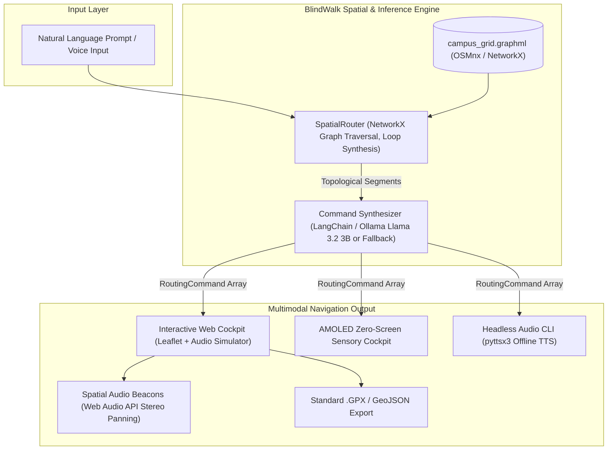

# BlindWalk 🌿
### Air-Gapped Spatial Routing & Screenless Sensory Audio Navigator

[](https://hacktoberfest.com/)
[-red?style=flat-square&logo=youtube)](https://www.youtube.com/watch?v=QFaH2oNeOLs)
[](https://sharan-s-dev.github.io/blind-walk/)
[](LICENSE)
[](https://python.org)

> Built for **Hacktoberfest 2026** by [Sharan Suresh](https://github.com/sharan-s-dev) (B.Tech CSE, Jain University).

Most navigation apps glue your eyes to a screen, watching blue dots on a map while piping your live location telemetry to remote cloud servers. **BlindWalk** is built to be completely eyes-free and offline: it translates localized path networks into landmark-based acoustic cues and spatial audio beacons, letting pedestrians and low-vision walkers navigate without looking down at a screen.

---

## 📺 Live Demo & Video Walkthrough

- 🌐 **Live Web Application:** [https://sharan-s-dev.github.io/blind-walk/](https://sharan-s-dev.github.io/blind-walk/)  
  *(Runs client-side in any modern browser — zero sign-up, zero installation, 100% free)*
- 🎬 **YouTube Video Walkthrough:** [BlindWalk: A Screenless Spatial Navigator (4 mins)](https://www.youtube.com/watch?v=QFaH2oNeOLs)


---

## 🎓 The Origin: Tested on College Campus Pathways

BlindWalk was inspired by daily walks across **Jain University Global Campus (Kanakapura Road, Bangalore)**. 

Between classes and labs, getting from the academic blocks to sports facilities or dining areas highlighted common limitations in mainstream map apps:
1. **Screen fixation is distracting outdoors:** Constantly looking down at a phone screen while walking on campus footpaths and dirt perimeter trails disconnects you from your surroundings and is unusable for visually impaired students.
2. **Standard maps are vehicle-centric:** Commercial GPS engines consistently route pedestrians down main asphalt vehicle roads, ignoring internal campus footpaths, shaded walkways, and unpaved perimeter trails.
3. **Data privacy & offline reliability:** Standard cloud maps track continuous GPS telemetry and fail when mobile data connectivity drops around campus perimeter fields.

I mapped out our campus layout node-by-node into an offline topological graph, giving students and walkers a way to calculate walking loops and navigate eyes-free through spoken cues and directional audio. While it started on my campus, BlindWalk is built to work anywhere in the world.

---

## ✨ What You Can Do

### 1. Interactive Web Cockpit (`web/`)
- **Natural Language Route Queries:** Type custom constraints or choose preset pills:
  - 🌿 *2 km Shaded Loop (Maximizes Tree Canopy)*
  - 🍂 *1.5 km Dirt Trail Walk*
  - 🏃 *800m Fast Quad Sprint*
  - 🌲 *3 km Forest Perimeter Exploration*
- **Live Walk Audio Simulator:** Hit **"Simulate Walk Audio"** to watch an avatar walk the route step-by-step while the browser vocalizes each instruction using natural speech synthesis.
- **Spatial Audio Beacons (Web Audio API):** Stereo-panned sound pings (left ear for left turns, right ear for right turns) designed for earbuds and bone-conduction headsets.
- **Multiple Map Layers:** Toggle between high-resolution Satellite Aerials (Esri World Imagery), Topographic OpenStreetMap, and Terrain Contours.
- **One-Click GIS Exports:** Export your route directly to standard **`.GPX`** (for Garmin watches / smartwatches / OsmAnd) or **GeoJSON** (for QGIS).

### 2. AMOLED "Zero-Screen" Sensory Mode
Press the **Zero-Screen Mode** button (or hit `Esc`):
- Replaces map graphics with a distraction-free, AMOLED pitch-black acoustic display featuring an **active soundwave oscilloscope** and large high-contrast step prompts.
- Full tactile keyboard shortcuts for walking without looking at the screen:
  - `[Space]` — Repeat current acoustic instruction
  - `[→]` — Advance to next waypoint
  - `[←]` — Step back to previous waypoint
  - `[Esc]` — Toggle between Zero-Screen mode and Map View

### 3. Headless Offline Terminal Engine (`blindwalk.py`)
For headless setups (e.g. Raspberry Pi running in a backpack with headphones):
- Run `python blindwalk.py --query "Calculate a 2-kilometer loop"`
- Instantly clears the terminal screen and speaks instructions offline through your audio jack using `pyttsx3`.

---

## 🗺️ Campus Presets & Worldwide Search

BlindWalk includes pre-compiled topological environments and a real-time global geocoding engine:

### 🎓 Primary Campus: Jain University Global Campus (Bangalore)
- **Coordinates:** Kanakapura Road (`12.6395° N, 77.4420° E`)
- **Verified Landmarks:**
  - 🏛️ **School of Engineering & Technology (SET Dome):** Central academic hub with wide pedestrian avenues.
  - ⛳ **Golf Course Shaded Trail:** Unpaved perimeter walkway buffering road traffic.
  - 🍲 **Campus Central Mess & Neem Corridor:** Tree-lined connector footpath.
  - 🏏 **Cricket & Football Grounds:** Athletic perimeter dirt tracks.
  - 🏊 **JIRS Swimming Pool & Sports Complex:** East connector path.
  - 🛕 **Jain Temple & Spiritual Garden:** Quiet contemplative garden path.
  - 🏟️ **Colloseum Amphitheater Walk:** Stone promenade along campus ridges.
  - 🔬 **Core Block & Aerospace Lab Walk:** West perimeter trail.

### 🏛️ Secondary Presets
- 🔬 **Indian Institute of Science (IISc Bangalore):** Faculty Hall, Gulmohar Marg canopy trail, Tala Marg Eucalyptus Avenue, and JRD Tata Memorial Library.
- 🌿 **Cubbon Park Nature Preserve (Central Bangalore):** State Central Library, Bamboo Grove trail, Bandstand, and Queen Victoria lawn dirt paths.
- 🌺 **Lalbagh Botanical Garden (South Bangalore):** Glass House promenade, Bonsai Garden, Lalbagh Lake boardwalk, and Kempegowda Rock ridge.
- ⛰️ **Nandi Hills Hiking Reserve:** Tipu Sultan Summer Palace, cliffside overlook, sacred Amrutha Sarovar lake path, and misty pine trail.

### 🌍 Dynamic Worldwide Geocoding
Enter any location worldwide into the search bar (e.g., *IIT Delhi*, *Christ University*, *Tokyo University*, *Oxford Brookes*, *Central Park NYC*). The engine resolves coordinates via OpenStreetMap Nominatim, centers the map, and synthesizes a local pedestrian walking loop dynamically.

---

## 🏗️ Architecture Under the Hood



---

## 🔒 Privacy & Local Routing

Commercial navigation apps continuously transmit location coordinates, velocity vectors, and user telemetry to cloud servers. BlindWalk is designed with privacy-first principles:

- **Local Execution:** The web app runs entirely client-side in your browser.
- **Offline LLM Inference:** In local server/CLI mode, natural language parsing runs completely on-device via **Ollama** (`llama3.2:3b`) with zero cloud API dependencies.
- **No Telemetry:** No user tracking, no third-party analytics, and zero coordinate logging.

---

## 🗣️ Turn-by-Turn Acoustic Log (Sample Walk)

When navigation starts, BlindWalk vocalizes directions step-by-step:

```
[00:00] "Route calculated for Jain Global Campus (Kanakapura). Total distance is 1.80 km across 8 waypoints."
[00:02] "Step 1. Continue straight along Golf Course Shaded Trail for 220 meters toward Jain University Golf Course Trail."
[00:04] "Step 2. Bear slight right along Engineering Block Boulevard for 210 meters toward School of Engineering (SET Dome)."
[00:06] "Step 3. Continue straight along Central Quad Neem Corridor for 100 meters toward Campus Central Mess. Dense neem shade."
[00:08] "Step 4. Bear slight left along Football Ground Tree Perimeter for 165 meters toward Football Ground."
[00:10] "Step 5. Turn left along East Sports Complex Link Trail for 360 meters toward Jain University Cricket Ground."
[00:12] "Step 6. Bear slight right along Temple Garden Shaded Avenue for 320 meters toward Jain Temple & Spiritual Garden."
[00:14] "Step 7. Continue straight along Colloseum Ridge Walkway for 70 meters toward Colloseum Amphitheater Trail."
[00:16] "Step 8. Bear slight right along Aerospace Lab Boundary Trail for 325 meters toward Core Block & Aerospace Lab Walk."
[00:18] "Navigation complete. You have arrived back at your destination."
```

---

## ⚡ Quickstart Guide

### 1. Run the Interactive Web Cockpit (Recommended)

You can launch the web dashboard immediately using Python or npm:

```bash
# Clone the repository
git clone https://github.com/sharan-s-dev/blind-walk.git
cd blind-walk

# Start the local server
npm start
# (Or: python server.py)
```

Open **[http://localhost:8000](http://localhost:8000)** in your browser!
- Click preset chips (e.g. **🌿 2 km Shaded Loop**).
- Click **"Simulate Walk Audio"** to test turn-by-turn voice pacing.
- Click **"Zero-Screen Mode"** to experience the screenless AMOLED interface.
- Click **"Export .GPX"** to download the path for your smartwatch.

> 💡 **Tip:** You can also open `web/index.html` directly in any browser without running a server.

### 2. Run the Headless Terminal Mode

For screen-free runs directly in your shell:
```bash
# Install dependencies
pip install -r requirements.txt

# Run the audio navigator
python blindwalk.py
```
Type your query and hit Enter. The terminal will clear itself and begin speaking directions through your speakers.

### 3. Run via Docker Compose

To run in an isolated container:
```bash
docker compose up -d
```
Access the web dashboard at `http://localhost:8000`.

### 4. Run the Automated Tests

```bash
npm test
# (Or: python -m unittest discover tests -v)
```
Output:
```
Ran 10 tests in 0.584s
OK (All 10 spatial geometry, loop algorithm, and parser tests passing)
```

---

## 🎯 Keyboard Shortcuts (Zero-Screen Mode)

| Key | Action |
| :--- | :--- |
| `[Space]` | Repeat current audio instruction |
| `[→]` (Right Arrow) | Skip to the next waypoint |
| `[←]` (Left Arrow) | Go back to the previous waypoint |
| `[Esc]` | Toggle between AMOLED Zero-Screen and Map View |

---

## 🤝 Contributing

Contributions are warmly welcomed! Feel free to check out [`CONTRIBUTING.md`](CONTRIBUTING.md) to help with:
- 🗺️ Adding new campus presets or nature trails to `config.py`
- 🌐 Adding multi-language voice synthesis support
- 🎧 Enhancing spatial audio beacon algorithms in the Web Audio API
- 📳 Extending haptic vibration patterns for mobile browsers

---

## 📜 License

Distributed under the **[MIT License](LICENSE)**. Built with pride for accessible, eyes-free outdoor navigation.
