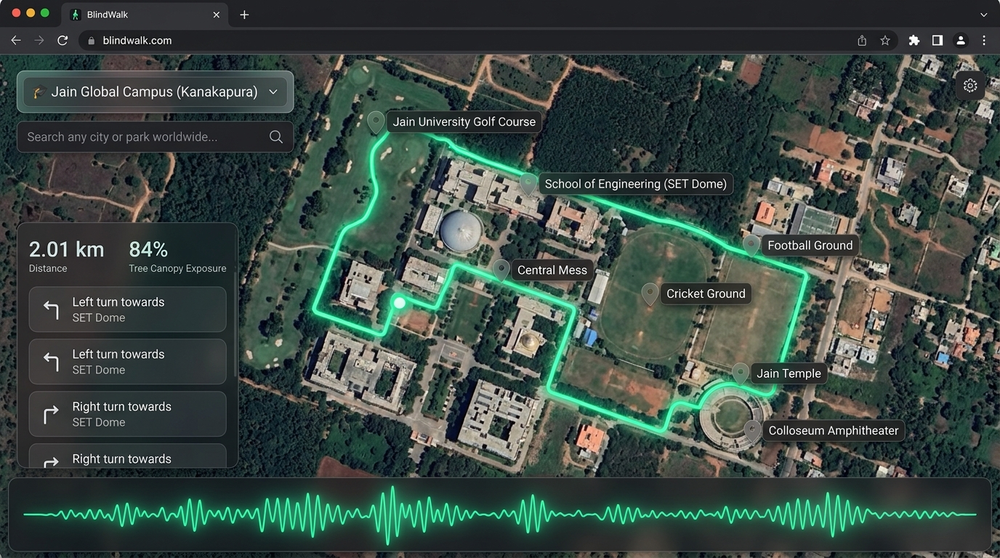

# BlindWalk

> Screenless, audio-first pedestrian navigation and loop routing engine.

[](https://www.youtube.com/watch?v=QFaH2oNeOLs)
[](https://sharan-s-dev.github.io/blind-walk/)
[](LICENSE)
[](https://python.org)

BlindWalk is an eyes-free pedestrian routing system. Instead of requiring users to continuously watch a map screen, it computes walking loops over localized path networks and delivers turn-by-turn directions purely through spoken audio cues, directional sound beacons, and an AMOLED screenless interface.

---

## Demo & Walkthrough

- **Live Web App:** [https://sharan-s-dev.github.io/blind-walk/](https://sharan-s-dev.github.io/blind-walk/)
- **Video Walkthrough:** (https://www.youtube.com/watch?v=QFaH2oNeOLs)



---

## Problem & Approach

Standard map applications (Google Maps, Apple Maps) are designed around visual displays and vehicle traffic:
- **Visual Distraction:** Walking while looking at a phone screen is awkward, distracting, and inaccessible for visually impaired or low-vision users.
- **Car-Biased Routing:** Standard engines favor paved roadways over footpaths, park trails, and pedestrian corridors.
- **Screen Glare:** Sunlight makes phone displays difficult to read outdoors.

**BlindWalk takes a different approach:**
1. **Pedestrian & Trail Prioritization:** Uses localized OpenStreetMap data via NetworkX to route over footways, unpaved trails, and walking paths.
2. **Audio-First Feedback:** Converts topological path segments into spoken directions using the browser's Web Speech API (or `pyttsx3` in CLI mode), supplemented by stereo-panned audio beacons (Web Audio API) indicating left/right turns.
3. **Screenless ("Zero-Screen") Mode:** Provides an AMOLED pitch-black interface with high-contrast text and tactile keyboard shortcuts (`Space` to repeat instruction, arrow keys to step through waypoints) so the phone can stay in a pocket.

---

## Core Features

- **Pedestrian Loop Synthesis:** Enter a distance or constraint (e.g., `"2 km loop"`, `"1.5 km dirt trail"`). The routing engine searches topological cycles to generate closed walking loops matching the target distance.
- **Turn-by-Turn Audio Guidance:** Vocalizes step distances, turns, and landmark waypoints with natural pacing.
- **Spatial Audio Beacons:** Uses stereo panning (Web Audio API) to sound audio pings in the left or right ear corresponding to upcoming turns.
- **AMOLED Zero-Screen Mode:** Replaces map rendering with an audio oscilloscope and readable instruction cards with tactile hotkeys.
- **Preloaded Topologies:** Built-in network presets for:
  - Jain University Global Campus (Kanakapura Road, Bangalore)
  - Indian Institute of Science (IISc Bangalore)
  - Cubbon Park Nature Preserve
  - Lalbagh Botanical Garden
  - Nandi Hills Hiking Reserve
- **Global OSM Search:** Integrated OpenStreetMap Nominatim search geocodes any university, park, or city worldwide to generate local pedestrian loops dynamically.
- **Multiple Map Layers:** Leaflet map supporting Esri World Imagery (satellite), OpenStreetMap (topographic), and terrain contour tiles.
- **GIS Export:** One-click export of calculated routes to standard `.gpx` (Garmin/smartwatches) and GeoJSON.
- **Headless Terminal Runner:** `blindwalk.py` allows running purely in the shell, clearing the terminal and speaking directions via offline TTS.

---

## Architecture

```
User Query / Location
         │
         ▼
┌──────────────────────────────────────────────┐
│            Routing & Spatial Engine          │
│  - Parses target distance & loop constraints │
│  - NetworkX graph traversal (OSM topology)   │
│  - Edge weighting (footways, trails, paths)  │
└──────────────────────┬───────────────────────┘
                       │ Path Segments
                       ▼
┌──────────────────────────────────────────────┐
│           Command Synthesis Layer            │
│  - Formats steps into turn-by-turn cues      │
│  - Optional: Local Ollama (llama3.2:3b)      │
│  - Deterministic fallback synthesizer        │
└──────────────────────┬───────────────────────┘
                       │ Structured Commands
         ┌─────────────┴─────────────┐
         ▼                           ▼
┌──────────────────┐       ┌──────────────────┐
│  Web Application │       │   Terminal CLI   │
│  (web/app.js)    │       │  (blindwalk.py)  │
│  - Leaflet Map   │       │  - Offline TTS   │
│  - Web Speech    │       │  - Zero visual   │
│  - Web Audio     │       │    terminal mode │
│  - Zero-Screen   │       └──────────────────┘
└──────────────────┘
```

---

## Tech Stack

| Layer | Technologies |
| :--- | :--- |
| **Frontend** | Vanilla JavaScript (ES6+), HTML5, CSS3, [Leaflet.js](https://leafletjs.com/) |
| **Audio & Speech** | Web Speech API, Web Audio API, `pyttsx3` (Python CLI) |
| **Spatial Graph** | Python 3.10+, [NetworkX](https://networkx.org/), [OSMnx](https://osmnx.readthedocs.io/), GraphML |
| **Inference (Optional)** | Local [Ollama](https://ollama.com/) (`llama3.2:3b`) via LangChain (deterministic offline fallback included) |
| **Server** | Python `http.server` (zero external dependencies) |

---

## Getting Started

### 1. Web Application

#### Option A: Direct Browser (No install needed)
Open `web/index.html` directly in any modern browser, or visit the [GitHub Pages live deployment](https://sharan-s-dev.github.io/blind-walk/).

#### Option B: Local Python Server
```bash
# Clone the repository
git clone https://github.com/sharan-s-dev/blind-walk.git
cd blind-walk

# Start local server
npm start
# (Or: python server.py)
```
Open **`http://localhost:8000`** in your browser.

---

### 2. Headless Terminal CLI

For running on single-board computers (e.g. Raspberry Pi) or distraction-free terminal use:

```bash
# Install dependencies
pip install -r requirements.txt

# Run interactive CLI
python blindwalk.py

# Or pass a query directly
python blindwalk.py --query "Calculate a 2-kilometer loop"
```

The terminal will clear itself and begin speaking directions through the system audio output.

---

### 3. Docker

To run via Docker Compose:

```bash
docker compose up -d
```
Access the web cockpit at `http://localhost:8000`.

---

## Keyboard Controls (Zero-Screen Mode)

When Zero-Screen mode is active (`Esc` to toggle):

| Key | Function |
| :--- | :--- |
| `[Space]` | Repeat current audio instruction |
| `[→]` (Right Arrow) | Advance to next waypoint |
| `[←]` (Left Arrow) | Return to previous waypoint |
| `[Esc]` | Toggle between Zero-Screen mode and Map View |

---

## Running Tests

The test suite covers spatial calculations, bearing logic, constraint parsing, and fallback synthesizers:

```bash
npm test
# (Or: python -m unittest discover tests -v)
```

---

## Project Structure

```
blind-walk/
├── web/
│   ├── index.html        # Web cockpit & AMOLED zero-screen interface
│   ├── app.js            # Pathfinding, Web Speech & Web Audio synthesis
│   ├── style.css         # AMOLED dark theme styling
│   └── preview.jpg       # Interface screenshot
├── engine/
│   ├── spatial.py        # NetworkX spatial router & OSM graph traversal
│   ├── llm_agent.py      # LangChain/Ollama agent + deterministic fallback
│   └── audio_output.py   # pyttsx3 offline acoustic navigator & CLI suppressor
├── tests/                # Unit and integration test suite
├── server.py             # Lightweight local HTTP API server
├── blindwalk.py          # Headless zero-screen terminal CLI
├── cache_map.py          # OSM data fetch and GraphML serialization
├── config.py             # Campus coordinate presets & configuration
├── requirements.txt      # Python dependencies
└── package.json          # Node script runner shortcuts
```

---

## License

This project is licensed under the [MIT License](LICENSE).
